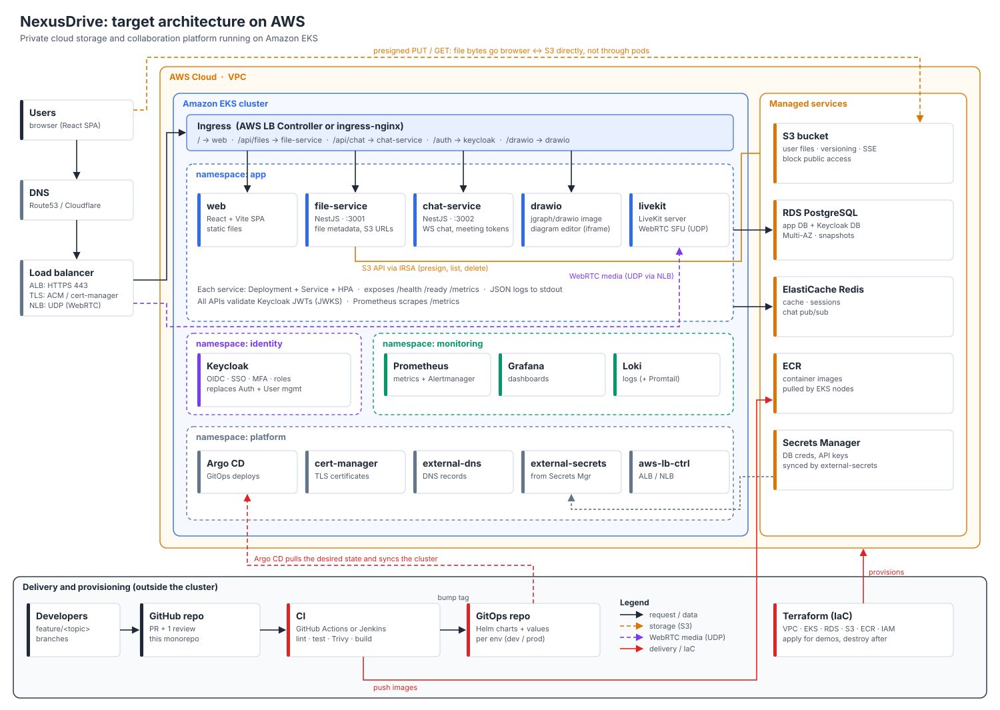

# ☁️ NexusDrive

A private cloud platform for file storage and collaboration (files, diagrams, chat and video meetings), built as a set of microservices and run on **Kubernetes (Amazon EKS)**.

> DevOps graduation project. The focus is on how the system is built, shipped, secured and operated.



---

## Application architecture

| Component               | Tech                      | Responsibility                                                             |
| ----------------------- | ------------------------- | -------------------------------------------------------------------------- |
| `apps/web`              | React + Vite (TypeScript) | Landing page, home dashboard, files, diagrams, chat, meetings board, admin |
| `services/file-service` | NestJS                    | Files on S3 through presigned URLs; visibility by department role          |
| `services/chat-service` | NestJS + socket.io        | Realtime chat (Postgres history, Redis fan-out); LiveKit meetings board    |
| `services/user-service` | NestJS                    | Users (via Keycloak Admin API) and departments (Postgres)                  |
| Keycloak                | upstream                  | Login, SSO, MFA, users and roles (OIDC)                                    |
| draw.io                 | upstream                  | Embedded diagram editor; diagrams saved to S3                              |
| LiveKit                 | upstream                  | WebRTC video/audio meetings                                                |
| PostgreSQL · Redis · S3 | managed on AWS            | Data, cache / pub-sub, file storage                                        |

- Every service validates **Keycloak JWTs** and exposes `/health`, `/ready` and `/metrics`. Logs are JSON, and all config comes from env vars. See [docs/service-contract.md](docs/service-contract.md).
- File bytes go **browser ↔ S3 directly**. Services only sign the URLs.

More detail: [docs/architecture.md](docs/architecture.md). Deploying it: [docs/deployment-notes.md](docs/deployment-notes.md).

## Deployment architecture

```
Users → DNS (Route53/Cloudflare) → AWS Load Balancer (TLS) → Ingress → EKS
  EKS namespaces
    app         web · file-service · chat-service · user-service · drawio · livekit (UDP via NLB)
    identity    keycloak
    platform    argo-cd · cert-manager · external-dns · external-secrets · aws-lb-controller
    monitoring  prometheus · grafana · loki
  AWS managed   RDS PostgreSQL · ElastiCache Redis · S3 · ECR · Secrets Manager
```

Everything is provisioned with Terraform. Pods reach AWS through IAM roles (IRSA), so there are no static keys.

## Planned DevOps features

| Area                   | Tools                                                                                      |
| ---------------------- | ------------------------------------------------------------------------------------------ |
| Infrastructure as Code | Terraform: VPC, EKS, RDS, S3, ECR, IAM                                                     |
| CI                     | GitHub Actions or Jenkins: lint, test, build, Trivy image scan, push to ECR                |
| CD / GitOps            | Helm charts per service, Argo CD, separate dev and prod environments                       |
| Networking             | Ingress, cert-manager (TLS), ExternalDNS, NetworkPolicies                                  |
| Secrets                | AWS Secrets Manager + External Secrets Operator                                            |
| Observability          | Prometheus, Grafana dashboards, Loki logs, Alertmanager                                    |
| Security               | Keycloak SSO/MFA, Pod Security Standards, least-privilege IAM, image scanning              |
| Reliability            | HPA autoscaling, PodDisruptionBudgets, RDS and Velero backups with a tested restore        |
| Cost control           | Local development on kind/k3d; AWS brought up for demos and torn down after; budget alarms |

## Repository layout

```
apps/web/              React frontend
services/              NestJS backend services
packages/common/       shared service code (auth, health, metrics, logging)
config/keycloak/       Keycloak realm (roles, web client)
docs/                  architecture, service contract, local development
arch/                  diagrams
```

## Getting started

Requires Node.js 22. See [docs/local-development.md](docs/local-development.md) for the backing services.

```bash
npm install
npm run build
npm test
```

## 👥 Team

| #   | Team member     |
| --- | --------------- |
| 1   | Anas Elfeky     |
| 2   | Mahmoud Khaled  |
| 3   | Aser Ahmed      |
| 4   | Mohamed Bahaa   |
| 5   | Elsayed Mohamed |
| 6   | Ali Abdou       |

🚧 **Status:** under development. Application skeleton is in place; infrastructure and pipelines are next.

**NexusDrive Team © 2026**
