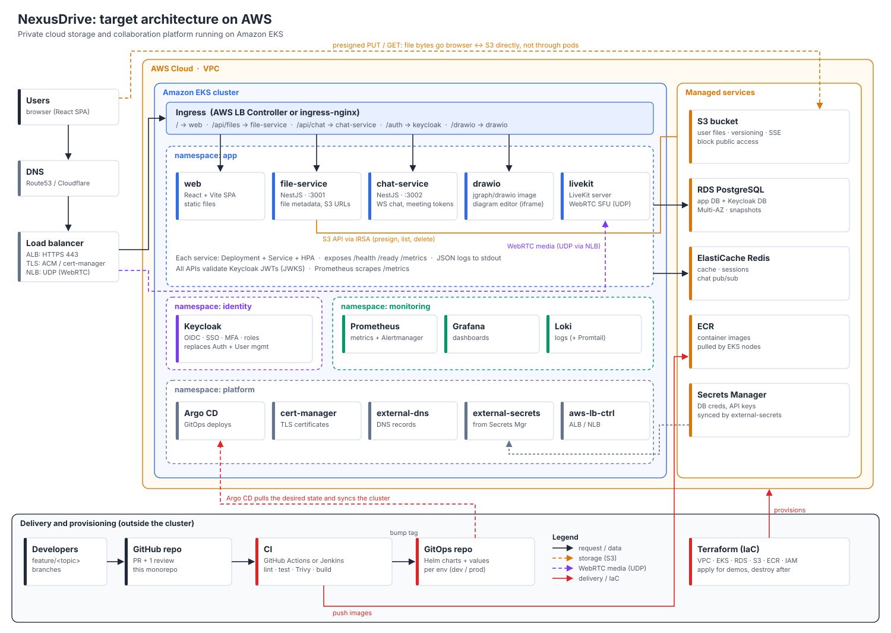

# Architecture

The first hand-drawn version is [`arch/arch.jpeg`](../arch/arch.jpeg). The diagram above is the revised target.

## Components

| Component              | Code                               | What it does                                                                                                                                                                                                                  |
| ---------------------- | ---------------------------------- | ----------------------------------------------------------------------------------------------------------------------------------------------------------------------------------------------------------------------------- |
| **web**                | `apps/web`                         | React + Vite single-page app: public landing page, home dashboard, files, diagrams, chat, meetings board, admin (users, departments). Logs in with Keycloak (OIDC + PKCE).                                                    |
| **file-service**       | `services/file-service`            | Lists the files a user may see and hands out short-lived **presigned S3 URLs**. The browser uploads and downloads directly to S3, so file bytes never pass through the pod. Asks user-service whose files the caller may see. |
| **chat-service**       | `services/chat-service`            | Realtime chat rooms over socket.io (history in Postgres, Redis adapter across replicas), plus the **meetings board**: creates LiveKit rooms, lists running ones, issues join tokens.                                          |
| **user-service**       | `services/user-service`            | Users (through the **Keycloak Admin REST API**) and the company structure: **departments** with a head, team leaders and workers, stored in Postgres. Decides file visibility.                                                |
| **Keycloak**           | upstream image + `config/keycloak` | Login, registration, SSO, MFA, users and roles (`user`, `admin`). Replaces the old auth-service; it is the source of truth that user-service manages.                                                                         |
| **draw.io**            | upstream image (`jgraph/drawio`)   | Diagram editor embedded in an iframe. Diagrams are saved to S3 as `.drawio` files through file-service.                                                                                                                       |
| **LiveKit**            | upstream image                     | WebRTC media server (SFU) for meetings. Needs UDP, so it's exposed with an NLB rather than the HTTP Ingress.                                                                                                                  |
| **@nexusdrive/common** | `packages/common`                  | Shared NestJS code: JWT guard, health/ready, metrics, logging, bootstrap. See [service-contract.md](service-contract.md).                                                                                                     |

## Main flows

**Login.** The browser is redirected to Keycloak and gets back an access token (JWT). Every API call sends `Authorization: Bearer <token>`. Services verify it locally against Keycloak's public keys (JWKS), so there's no call to an auth service per request.

**Upload a file.**

1. The browser calls `POST /api/files/upload-url`.
2. file-service returns a presigned PUT URL for `users//<name>`.
3. The browser PUTs the file straight to S3.

Downloads work the same way with a presigned GET URL.

**Departments and file visibility.** Admins create departments and place each user in at most one, as **head**, **team leader** or **worker** (a worker may report to one team leader). Everyone uploads into their own folder; what they can _see_ narrows from the top down:

| Role          | Sees the files of                           |
| ------------- | ------------------------------------------- |
| head          | everyone in the department                  |
| team leader   | themself and the workers who report to them |
| worker        | themself                                    |
| no department | themself                                    |

`GET /api/files` makes file-service call `GET /api/users/me/visibility` on user-service **with the caller's own token**, then lists each visible owner's S3 prefix. Downloading someone else's file (`?owner=`) is checked the same way and fails closed (503) if user-service is down; the listing falls back to own files only. Only the owner can overwrite or delete a file. Platform admins manage the structure but get no extra file access.

**Edit a diagram.** draw.io runs in an iframe. On load, the web app fetches the XML through a download URL. On save, it uploads the XML through an upload URL.

**Chat.** The Chat page shows every room as a tile. A room is for the whole company or one department, from a minimum role up (everyone / team leaders and head / head only), so access follows the same hierarchy as files. Admins create rooms anywhere; department heads create rooms for their own department. The browser opens socket.io (WebSocket transport only) at `/api/chat/socket.io`; on `join`, chat-service asks user-service for the caller's department (with the caller's token) and refuses rooms they may not enter. Messages are stored in Postgres and fanned out through the socket.io Redis adapter (`REDIS_URL`), so any number of replicas can run without sticky sessions. From a room, "Start a meeting" opens the meetings board with the title filled in.

**Meetings.** Meetings are LiveKit rooms, so LiveKit itself is the list of what's running; nothing is stored.

1. Start: `POST /api/chat/meetings { title }` creates a room (`m-<random>`, title in its metadata) and returns a join token.
2. Board: `GET /api/chat/meetings` lists running rooms; the web app shows them as tiles and refreshes every 5 s.
3. Join: clicking a tile calls `POST /api/chat/meetings/<room>/token` (404 if it has ended), then connects to LiveKit.
4. Audio and video flow browser ↔ LiveKit over UDP. An empty meeting closes after 5 minutes, or 30 s after the last person leaves.

**Manage users and departments.** The Admin page (admins only) calls `/api/users` and `/api/users/departments`. user-service checks the caller's `admin` role, then calls the Keycloak Admin REST API as its own service account (client-credentials grant). Admins can't demote or disable themselves.

## Why some boxes from the first drawing changed

- **Firebase was removed.** It's a Google SaaS and can't run in the cluster. Postgres and Redis cover chat storage and fan-out.
- **Auth Service was replaced by Keycloak.** Writing auth yourselves is a security risk, and Keycloak gives SSO, MFA and an admin UI for free. **User Management** survives as the small user-service, which manages users _in_ Keycloak instead of keeping its own user table.
- **Jenkins moved out of the app cluster.** CI must not share a failure or security domain with production, and must never talk to the app database.
- **Draw.io is its own deployment**, not part of file management.
